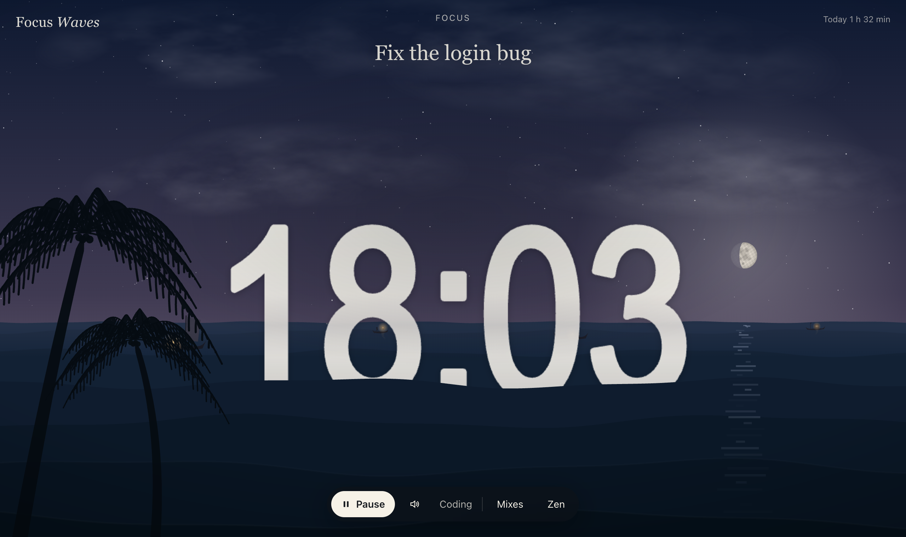
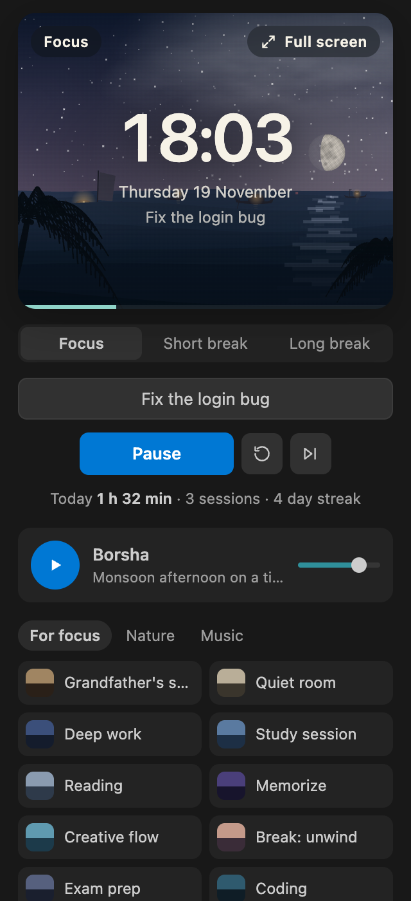

# Focus Waves for VS Code

**Sit by the sea. Get your code done.**

Focus Waves puts a focus timer in your status bar and plays calm sounds while you code: sea waves, rain on a tin roof, a ceiling fan, lofi beats, brown noise and more. Every sound is made live while you listen, so nothing loops and nothing repeats. Open the Focus Room for the living sea from [focus.freakingwaves.com](https://focus.freakingwaves.com), with your timer painted into the water.

## Features

- **Focus timer in the status bar.** Focus sessions with short and long breaks. The time left is always in view, and a soft chime tells you when to rest.
- **33 live sounds.** Waves, wind, birds, stream, fireplace, rain, tin roof, thunder, crickets, frogs, night train, purring cat, lofi, soft piano, guitar, bansuri, tanpura, fan, white, pink and brown noise, and more. Each one is a small simulation, not a recording.
- **87 ready mixes.** Coding, Deep work, Study session, Cox's Bazar, Borsha, Village dawn, Rainy night, Lofi and rain, and many more. Pick one in a click.
- **Focus pulse.** A gentle rhythm in the sound (Calm 6 Hz, Flow 10 Hz, Focus 14 Hz, Deep 16 Hz) with an intensity control.
- **Focus Room.** The living sea in an editor tab: it follows your time of day, and reacts to what you hear (foam when a wave breaks, lightning before thunder, birds when they sing). Your timer sits inside the water.
- **Stay in the zone.** Optional Zen Mode and Do Not Disturb during focus sessions, so nothing pulls you out.
- **Your focused time.** Today's total, sessions and your daily streak, plus the last 7 days.
- **Private and free.** No account, no tracking, no ads. Nothing leaves your computer.

## Getting started

1. Click the waves icon in the Activity Bar.
2. Pick a mix (try **Coding**) and click anywhere in the panel once. VS Code asks for one click before any extension can play sound.
3. Press **Start focus**, or click **Focus** in the status bar.

After that first click, the status bar controls work on their own for the rest of the session.

## Commands and shortcuts

| Action | Shortcut |
|---|---|
| Pause or resume the timer | `Ctrl+Alt+F` (`Cmd+Alt+F` on Mac) |
| Play or pause sounds | `Ctrl+Alt+M` (`Cmd+Alt+M` on Mac) |

Everything else is in the Command Palette under **Focus Waves**: Start Focus Session, Skip, Reset, Choose a Mix, Open Focus Room, Set What You Are Working On, Show Focus Stats, Volume Up and Down.

## Settings

| Setting | Default | |
|---|---|---|
| `focuswaves.focusMinutes` | 25 | Length of a focus session |
| `focuswaves.shortBreakMinutes` | 5 | Short break |
| `focuswaves.longBreakMinutes` | 15 | Long break |
| `focuswaves.longBreakEvery` | 4 | Every how many sessions the break is long |
| `focuswaves.autoStartBreaks` | false | Start breaks on their own |
| `focuswaves.autoStartFocus` | false | Start the next session on its own |
| `focuswaves.soundWithFocus` | true | Start your sounds with a focus session |
| `focuswaves.chime` | true | Chime when a session or break ends |
| `focuswaves.zenModeDuringFocus` | false | Zen Mode during focus |
| `focuswaves.quietNotificationsDuringFocus` | false | Do Not Disturb during focus |
| `focuswaves.showInStatusBar` | true | Show the timer and sound in the status bar |

## Good to know

- Best with headphones.
- The sounds are synthesised live, so they use a little CPU. If they stutter on a slow machine, choose a mix with fewer sounds.
- The research on focus pulses and binaural beats is promising but not settled, and effects differ from person to person. Focus Waves makes no medical claims.
- Want the full experience, with the Quran player and clock faces? Visit [focus.freakingwaves.com](https://focus.freakingwaves.com).

## About the developer

Made by **Fahad Mahmud** (BUET CSE, ex-NDC), founder of Freaking Waves.

- Portfolio: [fahadmahmud.com](https://fahadmahmud.com)
- Website: [freakingwaves.com](https://freakingwaves.com)
- Facebook: [facebook.com/fahadmahmud2004](https://www.facebook.com/fahadmahmud2004)
- Facebook Page: [facebook.com/freakingw](https://www.facebook.com/freakingw)
- Facebook Group: [facebook.com/groups/freakingwaves](https://www.facebook.com/groups/freakingwaves)
- Telegram Community: [t.me/freakingwaves](https://t.me/freakingwaves)
- GitHub: [github.com/fahadmahmud2004](https://github.com/fahadmahmud2004)

Other extensions by Fahad: [ThirdNote](https://marketplace.visualstudio.com/items?itemName=fahadmahmud2004.thirdnote) (code highlights, notes and flashcard review) and [Focus Waves](https://marketplace.visualstudio.com/items?itemName=fahadmahmud2004.focuswaves) (focus timer and live nature sounds).
